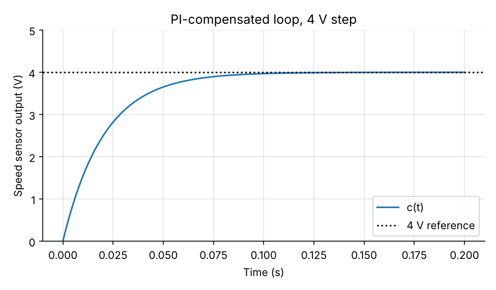
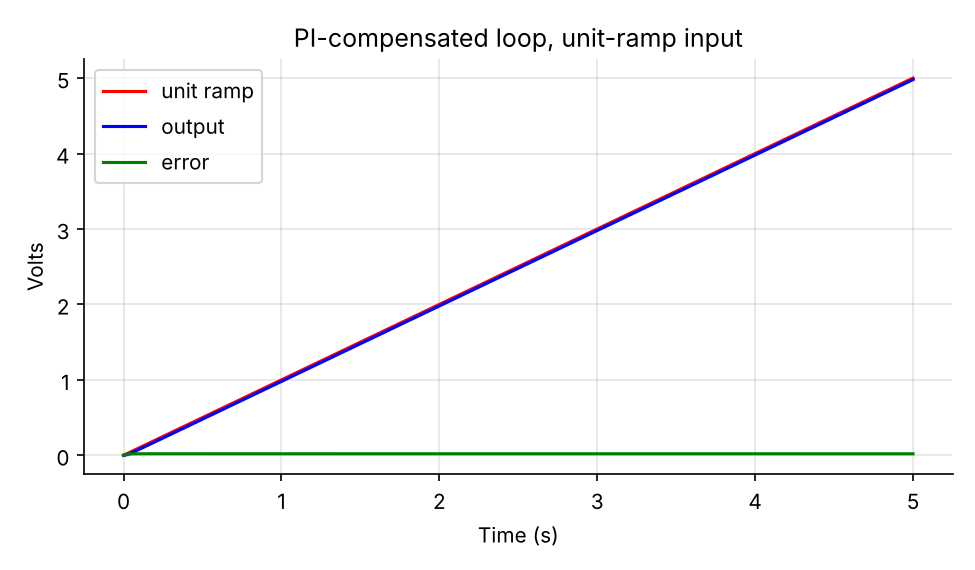
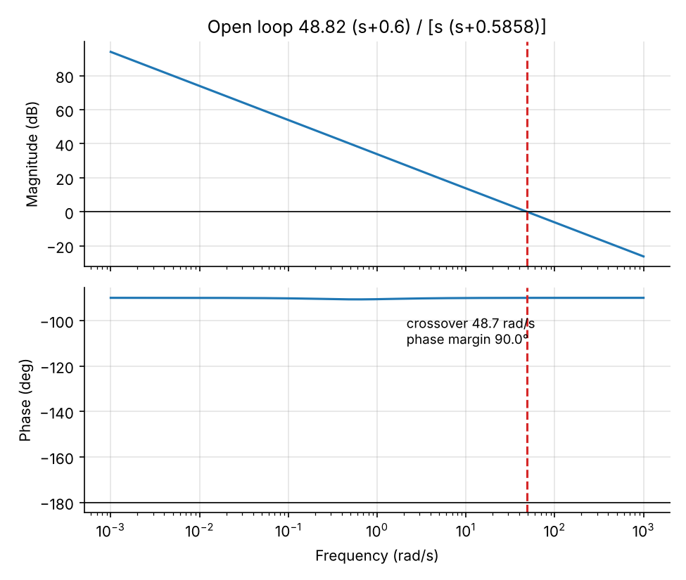
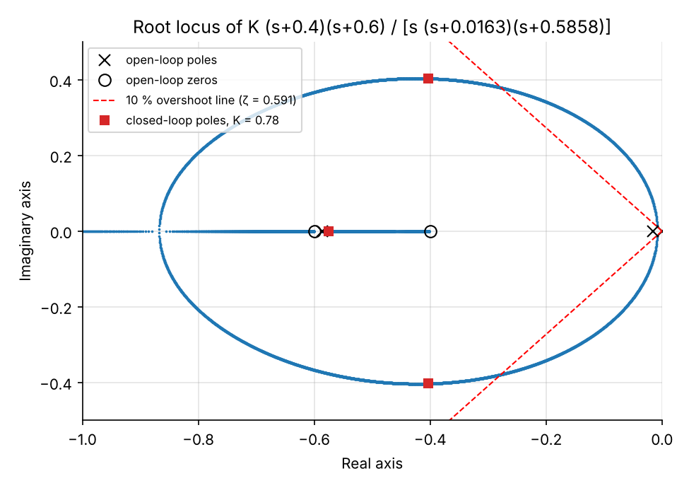
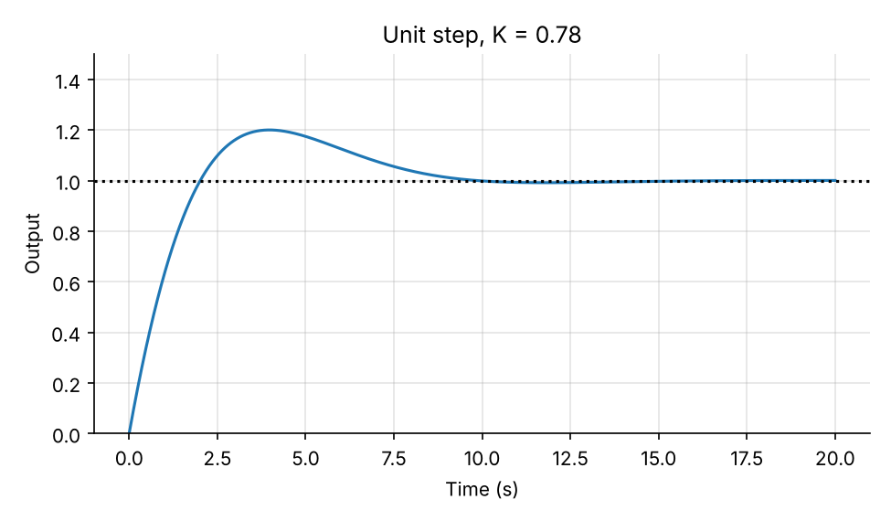
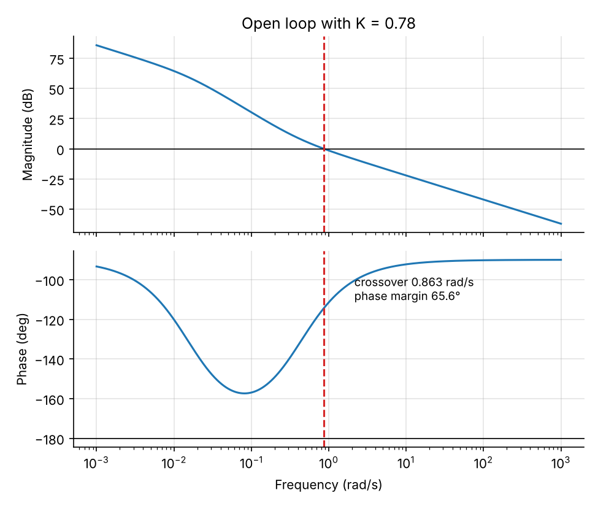
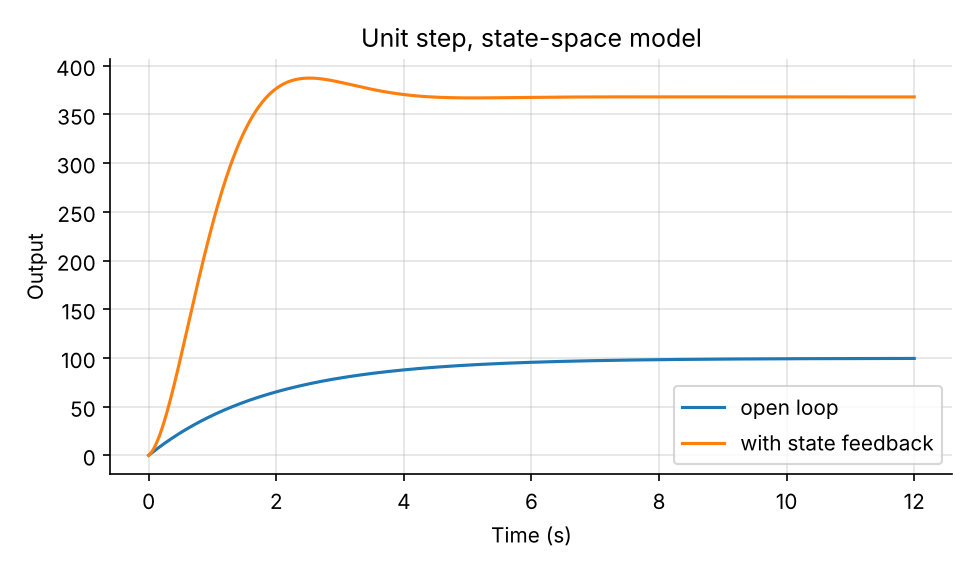
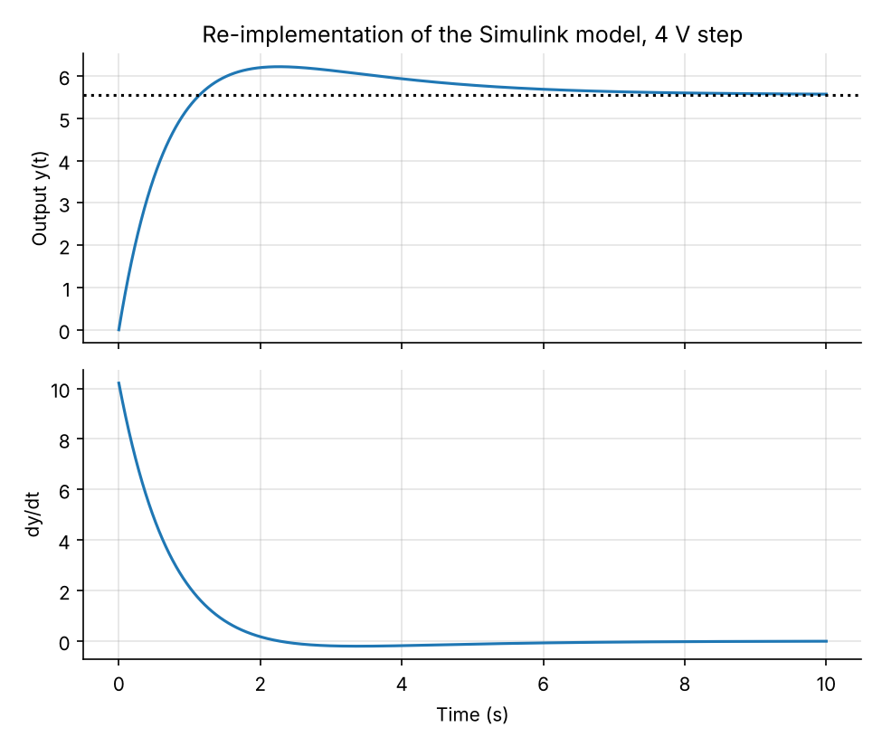

# Modern Control Project: 
## Hybrid Electric Vehicle Traction-Motor Speed Control

Author: Hossein Mosaffa

Course: Modern Control Project at Amirkabir University of Technology, Faculty of Electrical Engineering

## 1. Overview

This project designs and analyses feedback controllers for the speed-control loop of a hybrid electric vehicle traction motor. In a hybrid vehicle, an electric motor can drive the wheels directly or assist the internal-combustion engine. The controller regulates motor speed by comparing a commanded speed signal with the voltage produced by a speed sensor on the motor shaft.

The plant is represented by a linearized model that combines the traction motor, its mechanical load, and the speed sensor. The controller output is interpreted as a command to the motor drive, while the measured output is the speed-sensor voltage. The model does not include battery dynamics, power-electronics dynamics, engine operation, transmission behaviour, road-load disturbances, or the nonlinear dynamics of the complete vehicle. Those effects are outside the scope of this control-design study.

The project contains four studies: PI compensation analysed in the time and frequency domains, root-locus design of a third-order loop, state-feedback control using eigenvector assignment, and a Simulink model with two nested PI loops. Each study is a short MATLAB script, except the last, which is the Simulink file `simulation.slx`.

All numbers in this report were computed with `make_figures.py`, a Python re-implementation of the MATLAB scripts. The figures are Python plots too. If you run the MATLAB files you should get the same curves for the transfer-function scripts. For the Simulink model, the Python version is an independent reading of the block diagram and has not been compared against a Simulink run (see section 7).

## 2. Part 1: PI-compensated traction-motor loop

Files: `controller with rootlocus.m`, `controller with frequency.m`

### Model

The controlled system is a simplified hybrid-electric-vehicle traction-motor speed loop. The motor receives a control voltage from its drive system, accelerates the driveline load, and a speed sensor returns a voltage proportional to shaft speed.

For the PI-compensated design, the open-loop transfer function is

G(s) = 48.83 (s + 0.6) / [ s (s + 0.5858) ]

The factor (s + 0.6) / s is a PI compensator. Removing it leaves an approximate motor-and-sensor model,

G_m(s) = 48.82 / (s + 0.5858)

This first-order model represents the combined dynamics of the traction motor, driveline load, and speed sensor. Its time constant is 1 / 0.5858 = 1.71 s, and its DC gain is 48.82 / 0.5858 = 83.4. The PI compensator adds integral action so that the motor speed tracks a commanded speed with zero steady-state error after a step change.

In a real hybrid vehicle, the motor command would be produced by an inverter and battery system, while the load would include the drivetrain, vehicle inertia, road resistance, and possible engine torque. This project deliberately reduces that system to a linear speed loop so that classical and state-space control methods can be applied clearly. The interpretation is therefore: the input is the commanded motor-speed voltage, and the output is the speed-sensor voltage.

The PI compensator zero at −0.6 sits right next to the plant pole at −0.5858, so the two almost cancel. What remains is an integrator and a gain of about 48.8. The script closes the loop with unity feedback and calls `minreal` to remove the leftover pole-zero pair.

### Closed-loop behaviour

The closed-loop poles are at −48.82 and −0.600, and there is a zero at −0.600. The slow pole and the zero cancel almost exactly, which leaves a fast first-order response with a time constant of about 0.02 s. For the 4 V step that gives:

| Metric | Value |
|---|---|
| Final value | 4 V |
| Overshoot | about 0.02 % |
| 10 to 90 % rise time | 0.045 s |
| 2 % settling time | 0.080 s |



The loop has one integrator, so it is type 1. It follows a step with zero steady-state error and a ramp with a constant error of 1/Kv. Here Kv = 29.3 / 0.5858 = 50.0, so the error to a unit ramp settles at about 0.02. The second half of `controller with rootlocus.m` shows this by driving the closed loop with a ramp (the green curve below).



### Frequency response

`controller with frequency.m` repeats the loop with a gain of 48.82 (the other file uses 48.83) and starts with a Bode plot. The gain crosses 0 dB near 49 rad/s with a phase margin of about 90°. The phase of the loop never reaches −180°. It starts at −90° because of the integrator and stays close to that, since the compensator zero and the plant pole nearly cancel. So there is no finite phase crossover and the gain margin is infinite. That agrees with the step response having essentially no overshoot.



## 3. Part 2: root locus of a third-order traction-motor loop

Files: `rootlocus.m`, `frequency responce.m`

### Model

The loop here is

G(s) = K (s + 0.4)(s + 0.6) / [ s (s + 0.0163)(s + 0.5858) ]

This is a third-order model of the traction-motor speed-control loop. It includes an integrator, two zeros, and three poles. The pole at −0.0163 represents a slower dynamic mode in the linearized motor, driveline, or sensor model. The loop is type 1 because of the pole at the origin.

### Root locus and the overshoot line

`rootlocus.m` draws the locus and adds a line for 10 % overshoot. For a second-order system the damping ratio that gives 10 % overshoot is

ζ = −ln(0.10) / √(π² + ln²(0.10)) = 0.591

which is a line at 53.8° from the negative real axis. Two branches start at the poles at 0 and −0.0163. They meet, break away into the complex plane, loop around to the left and return to the real axis at roughly −0.87, where one branch heads for the zero at −0.6 and the other runs off to −∞. The third branch starts at the pole at −0.5858 and moves right along the real axis towards the zero at −0.4. The complex branches cross the 10 % line at K ≈ 0.53.



After the plot the script calls `rlocfind`, which lets you click on the locus to choose K. The step response of that closed loop is then plotted over 0 to 20 s.

### The chosen gain

`frequency responce.m` uses K = 0.78 (the numerator is 0.78 (s² + s + 0.24)). This assumes it is the gain picked with `rlocfind`, since the two files describe the same loop. If so, the closed-loop poles are at −0.403 ± 0.403j and −0.575. The complex pair has a damping ratio of 0.707, which is more damped than the 10 % line asks for, so the pair sits on the damped side of that line, closer to the real axis.

The step response is a different story from what the damping ratio alone would suggest:

| Metric (K = 0.78, unit step) | Value |
|---|---|
| Overshoot | about 20 % |
| 10 to 90 % rise time | 1.5 s |
| 2 % settling time | 8.6 s |



A second-order system with ζ = 0.707 would overshoot by about 4 %. The extra overshoot comes from the two zeros. In a unity-feedback loop the closed-loop zeros are the open-loop zeros, so −0.4 and −0.6 stay in the closed-loop transfer function and push the response up. The real pole at −0.575 sits almost on top of the zero at −0.6 and has little effect. The point to take from this is that the 10 % line only describes the dominant pole pair. It does not guarantee 10 % overshoot in the step response when the loop has zeros close to those poles. At K ≈ 0.53, where the pair is exactly on the line, the step overshoot is actually larger, about 24 %, because the poles are less damped and the same zeros are still there.

### Frequency response

With K = 0.78 the Bode plot crosses 0 dB at about 0.86 rad/s with a phase margin near 66°. As in Part 1, the phase never reaches −180°. At high frequency it tends to −90°, because the two zeros offset the lag of two of the three poles, so the gain margin is infinite. The velocity constant is Kv = 0.78 · 0.24 / (0.0163 · 0.5858) ≈ 19.6, so the unit-ramp error would be about 0.051.



## 4. Part 3: state feedback by eigenvector assignment

File: `controller with linear feedback.m`

### Model

The state-space model in the script is

A = [ −20 −40 ; 0.2491 −0.0191 ], B = [ 0 ; 1000 ], C = [ 0 0.05154 ], D = 0

This second-order state-space model is interpreted as a linearized traction-motor speed-control model. The states are internal motor and driveline variables, the input is the motor-drive command, and the measured output is the speed-sensor voltage. The open-loop poles are at −19.49 and −0.531.

### Method

The script appears to place the closed-loop poles at −1 ± j by choosing the closed-loop eigenvectors. For the pole λ = −1 − j, the matrix `a` in the script is exactly λI − A. Solving `a · c = B` gives a vector that points in the direction the eigenvector has to take. Dividing it by 1000 gives the vector `r` that is typed into the script. The gain is then found from the condition K · [r, conj(r)] = [−0.001, −0.001], which is what `K = [-0.001 -0.001] * inv(P)` does. With K real, the second column handles the conjugate pole −1 + j. The script then forms A − BK, discards the zero imaginary residue with `real`, builds the closed-loop state-space model and plots its step response.

### Result

The gain that comes out of the script is K = [−0.00868, −0.01773], and the closed-loop poles land at −1.15 ± 1.22j, not at −1 ± j. The cause is a rounding in `r`. The first entry is typed as 0.9251 − 1.72j, but the exact value is 0.9251 − 1.7233j. The construction is sensitive to that digit. With the exact eigenvector the same method gives K = [−0.00880, −0.01802] and poles at exactly −1 ± j.

The closed-loop transfer function with the typed values is

(51.54 s + 1030.8) / (s² + 2.291 s + 2.801)



The closed-loop step response has a DC gain of about 368 and a peak of about 387, so roughly 5 % overshoot. The large numbers are not an error in the response. They come from B = 1000 and the fact that nothing in the script scales the reference. Without a prefilter or reference gain, state feedback by itself does not make the DC gain equal to 1.

## 5. Part 4: Simulink model

File: `simulation.slx`

### Structure

The Simulink model represents a simplified hybrid-electric-vehicle traction-motor speed-control system with two nested feedback loops. The outer loop regulates the commanded speed, while the inner loop regulates an intermediate motor or drive variable. Each loop uses a PI controller; the D term is zero in both.

Reading the signal flow from the file, with x the output of the integrator block 1/(7.226 s):

1. A step of 4 at t = 0 is the reference r.
2. e1 = r − 0.0443 x
3. The first PID block (P = 100, I = 40) turns e1 into u1.
4. e2 = u1 − 0.5 v
5. The second PID block (P = 10, I = 6) turns e2 into u2.
6. v = u2 − 2 x
7. The plant is x' = (1.8 v − 0.6154 y − 0.1 x) / 7.226, where y = (0.3 / 4.875) x = 0.06154 x.

The two XY Graph blocks plot y against time (axes 0 to 8 s and 0 to 10) and dy/dt against time (axes 0 to 12 s and −1 to 12). The solver is variable-step with a stop time of 10 s.

### Behaviour

Because the outer PI controller contains an integrator, it forces e1 to zero in steady state, so x settles at r / 0.0443 = 90.3. The plotted output y = 0.06154 x therefore settles at about 5.56, not at the 4 V reference. The feedback gain 0.0443 and the output gain 0.06154 are different, so the plotted output does not equal the reference in steady state.

From the Python version of the model:

| Metric (4 V step) | Value |
|---|---|
| Final value of y | 5.56 |
| Peak value | 6.22 at 2.27 s |
| Overshoot | about 12 % |
| 10 to 90 % rise time | 0.82 s |
| 2 % settling time | 6.2 s |
| Largest slope dy/dt | about 10.2, at t = 0 |



The linearised closed loop has three real poles, at −1.23, −0.69 and −0.52, so it is stable. The overshoot comes from the zeros of the two PI controllers, as in Part 2. The peak slope of 10.2 and the output range up to about 6 are consistent with the axis limits set on the two XY Graph blocks, which suggests the Python version behaves like the model.

## 6. Summary

| Study | Main outcome |
|---|---|
| PI loop, time domain | Fast, nearly first-order traction-motor speed response, ramp error about 0.02 |
| PI loop, frequency domain | Crossover near 49 rad/s, phase margin about 90°, infinite gain margin |
| Root locus, K = 0.78 | Poles at −0.403 ± 0.403j and −0.575, overshoot about 20 %, phase margin about 66° |
| State feedback | Poles at about −1.15 ± 1.22j, about −1 ± j with an unrounded eigenvector |
| Simulink model | Stable, output settles at 5.56 with about 12 % overshoot |

## 7. Notes and open points

* The plant numbers differ between files. The slow pole is at −0.0163 in the root-locus files and does not appear in the PI files. In the state-space script, the entries 0.2491 and −0.0191 match the Simulink plant (1.8 / 7.226, and (0.1 + 0.6154 · 0.06154) / 7.226), but the −20, −40 and 1000 do not correspond to anything in the Simulink file that could be traced. The output gain is 0.05154 in the script and 0.06154 in Simulink. These may be different versions of the same plant, or the scripts may have been written against a different formulation. This should be confirmed against the assignment.
* The gain of 0.78 in `frequency responce.m` is hard-coded. See Part 2.
* The Simulink results come from the block diagram solved in Python, not from a Simulink run. The algebraic loop through the 0.5 gain was solved by hand in the Python version.
* The root-locus gain is chosen by clicking, so two runs of `rootlocus.m` can give slightly different responses.
* The hybrid-vehicle interpretation is a modelling assumption. The available files identify a speed-control loop and a speed-sensor output, but they do not provide hybrid-vehicle parameters or a full vehicle model. The traction-motor interpretation is therefore a simplified, control-oriented description rather than a detailed hybrid powertrain model.

## 8. Reproducing the figures

```bash
pip install numpy scipy matplotlib
python docs/make_figures.py
```

The script writes the PNG files to `docs/figures/` and prints every number quoted above. To use your own MATLAB plots instead, export them with `exportgraphics` and replace the files in that folder under the same names.